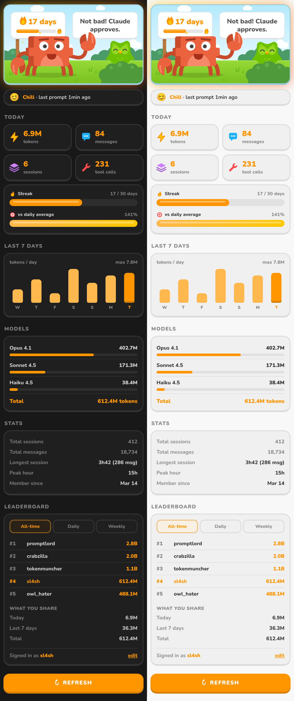
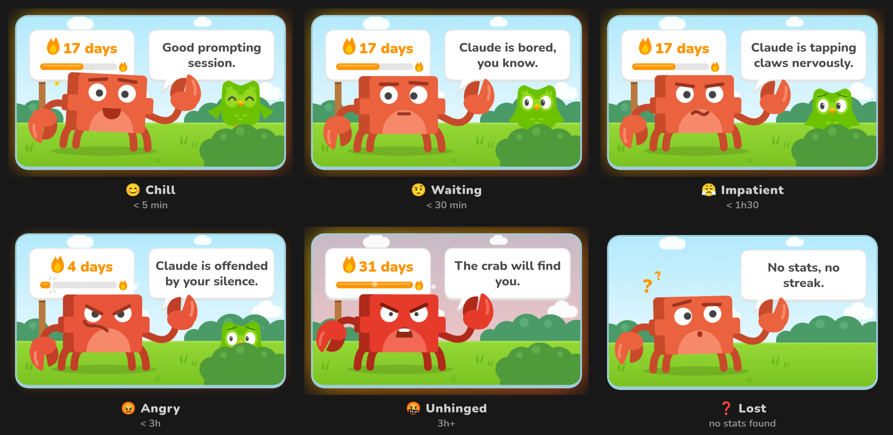

# Claudolingo

A Duolingo-inspired VS Code extension that tracks your Claude Code usage with a passive-aggressive crab mascot.

<p align="center">
  
</p>

## What it does

Claudolingo lives in your Activity Bar and watches your Claude Pro token usage in real time. The crab has opinions about your prompting habits — and it's not afraid to share them.

- **Animated scene** — a vector crab and owl that react to your mood: the crab dances, taps its foot, shakes its claws or loses it completely; the owl cheers, worries, then hides behind the bush. Click the crab to make it jump and say something new
- **Streak counter** — tracks consecutive days of Claude usage, displayed on the crab scene
- **Mood system** — the crab's mood changes based on how recently you've used Claude:
  - **Chill** (< 5 min ago) — the crab is happy
  - **Waiting** (< 30 min) — getting restless
  - **Impatient** (< 1h30) — tapping claws
  - **Angry** (< 3h) — offended
  - **Unhinged** (3h+) — chaos mode
- **Live stats** — tokens, messages, sessions, and tool calls for today
- **7-day activity chart** — bar chart of your daily token usage
- **Model breakdown** — token usage per Claude model
- **Fire glow** — the crab scene glows brighter as your streak grows (7d, 14d, 30d thresholds)
- **Duolingo look** — Nunito font, chunky 3D cards and buttons, orange accent, animated counters and bars; follows your VS Code light/dark theme
- **Nag notifications** — mood-based popup reminders when you haven't prompted in a while
- **Easter egg** — hit 1 billion tokens in a single day and something special happens



## How it works

Claudolingo reads your local Claude Code stats.  
No data leaves your machine.  
The extension is fully offline.

## Project structure

```
src/
  extension.ts        activation, refresh loop
  commands.ts         commands + nag notifications
  statusBar.ts        status bar item
  stats/              reading ~/.claude and computing a Snapshot
  webview/            panel provider, HTML (dashboard, error page), i18n, icons
media/
  scene/              one SVG per scene element (sky, sign, bubble, owl, bush, crab)
  webview/            style.css (panel), scene.css (crab & owl animations), main.js
  fonts/              Nunito (SIL Open Font License)
  messages.json       crab lines per mood
```

All scene parts share the same `800x450` viewBox and are stacked by `src/webview/scene.ts`.

## Installation

### From `.vsix` (recommended)

```bash
cd Claudolingo
npm install
npm run build
npm run package
```

This generates a `claudolingo-0.2.0.vsix` file. Install it with:

```bash
code --install-extension claudolingo-0.2.0.vsix
```

Then restart VS Code. The crab icon appears in the Activity Bar.

> **Note:** You need `@vscode/vsce` to package. Install it once with `npm install -g @vscode/vsce`.

### Development mode

Press `F5` in VS Code to launch the Extension Development Host with live reloading.

## Commands

| Command | Description |
|---------|-------------|
| `Claudolingo : j'ai utilisé Claude !` | Refresh stats and get a positive message |
| `Claudolingo : voir mon streak` | Show streak, tokens, and messages in a notification |

## Settings

| Setting | Default | Description |
|---------|---------|-------------|
| `claudolingo.language` | `fr` | Message language (`fr` or `en`) |
| `claudolingo.enabled` | `true` | Enable/disable the extension |
| `claudolingo.reminderIntervalMinutes` | `45` | Minutes before the crab starts nagging |